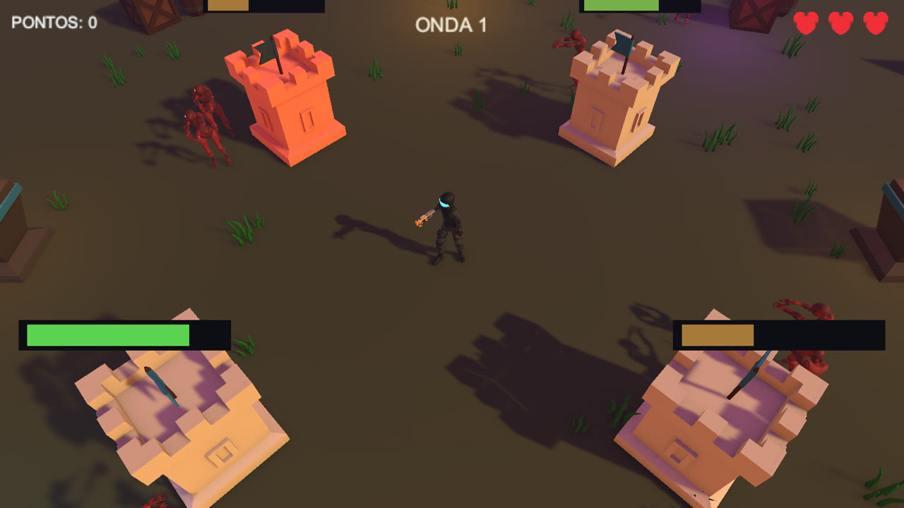
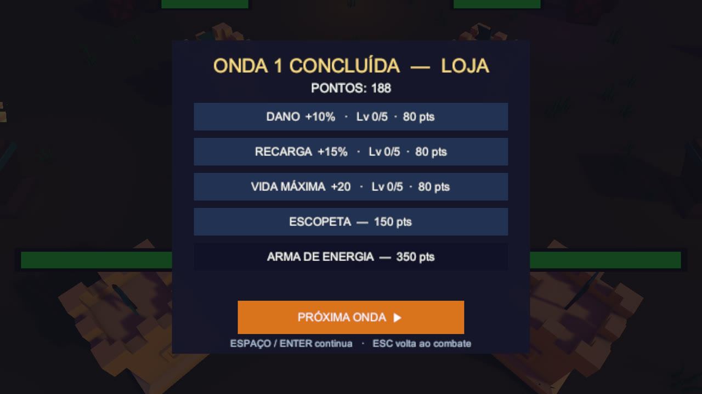
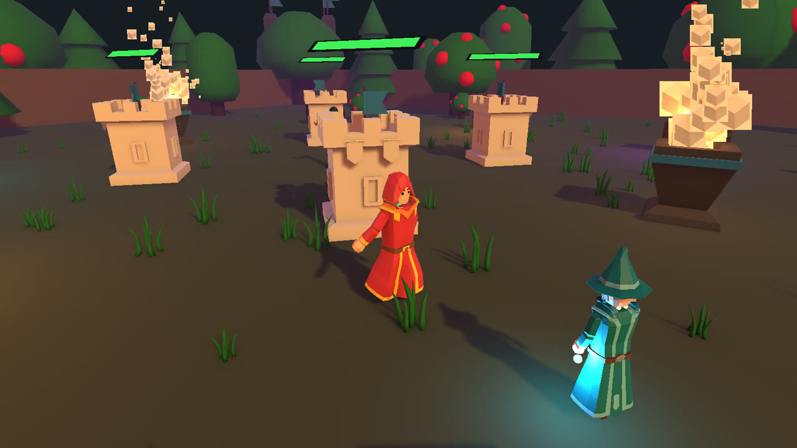
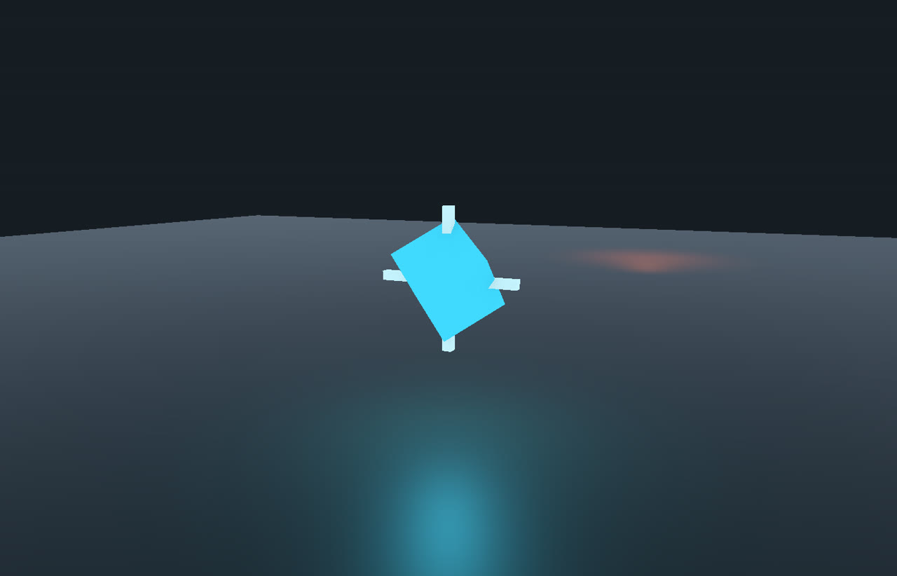
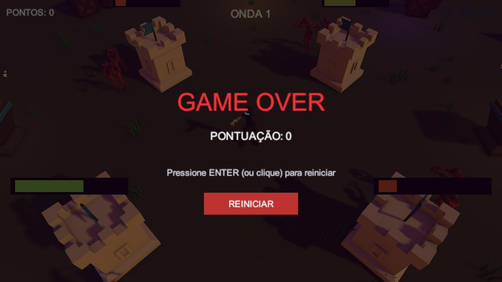

# Arena Survivor

Jogo de arena em 3D, com câmera elevada, ondas de inimigos, torres para defender e loja
entre as ondas. Feito na **Unity 6 (URP)** como projeto da disciplina de
**Realidade Virtual** da UTFPR.

O jogador defende quatro torres de pedra: os monstros descem em ondas cada vez mais
rápidas, os bruxos conjuram magias e, a cada onda limpa, nasce no chão um ícone de poder
que evolui a arma. Entre uma onda e outra abre a loja, onde os pontos viram dano, cadência,
vida e armas novas.



| Loja entre ondas | Inimigos e torres |
| --- | --- |
|  |  |

| Ícone de poder | Game over |
| --- | --- |
|  |  |

## Funcionalidades

- **Ondas progressivas**: quantidade, vida e velocidade crescem por onda
  (vida calibrada em "2 tiros na onda 1, 3 na onda 2, …").
- **Quatro inimigos** com NavMesh, animação e áudio 3D: bruto (perseguidor), cuspidor
  (atirador), espectro (furtivo) e o **mago chefe**, que conjura leque de projéteis,
  área de fogo e invoca lacaios.
- **Bruxos com poderes visíveis**: orbe pulsante na mão durante a conjuração e aviso
  colorido no chão antes do ataque.
- **Torres**: cada torre tem vida própria, barra de vida no mundo e pode ser destruída.
  O jogo termina quando a última torre cai.
- **Três armas** com munição, recarga e recuo: pistola, escopeta e arma de energia
  (perfurante). Liberadas na loja ou pelos ícones de poder.
- **Mira assistida** + colisão por varredura: a bala não atravessa o inimigo entre frames,
  e um tiro que passa perto é levemente puxado para o peito do alvo.
- **Nocaute e renascimento**: ao perder a vida o jogador volta em 1,6 s, com
  invulnerabilidade curta e −50 pontos (não é game over imediato).
- **Loja entre ondas**: upgrades de dano, recarga e vida máxima, além do desbloqueio das
  armas; navegável por mouse ou teclado.
- **Ícone de poder**: ao limpar a onda brota o poder no local do último inimigo morto e a
  sequência evolui (velocidade → arma → cadência → dano → vida), ficando mais forte a
  cada ciclo.
- **HUD e telas**: corações, pontos, tempo, torres vivas, tela de game over com
  detalhamento da pontuação e tela de vitória.
- **Apresentação**: skins texturizadas pintadas por osso, barras de vida procedurais,
  arena de floresta com castelos, tochas e partículas.

## Stack

| Camada | Tecnologia |
| --- | --- |
| Engine | Unity 6000.5.9f1 (Unity 6.5) |
| Renderização | Universal Render Pipeline (URP) 17.0.1 |
| Linguagem | C# |
| IA | NavMesh (Unity AI) |
| UI | uGUI + TextMesh Pro |
| Entrada | Input System (modo *Both*) com serviço próprio de input |
| Áudio | AudioSource 3D + Sound Manager |
| Plataforma | Windows / macOS / Linux (desktop) |

## Controles

| Ação | Tecla / mouse |
| --- | --- |
| Mover | `W` `A` `S` `D` ou setas |
| Mirar | mouse |
| Atirar | botão esquerdo |
| Recarregar | `R` |
| Esquiva | `Shift` ou `Espaço` |
| Trocar de arma | `1` `2` `3` ou roda do mouse |
| Loja: comprar | clique no item |
| Loja: próxima onda | `Espaço`, `Enter`, `N` ou `Esc` |
| Game over / vitória: reiniciar | `R`, `Enter`, `Espaço` ou clique |

## Como executar

Requisitos:

- Unity Hub com **Unity 6000.5.9f1** instalado.

Passos:

1. Baixe o repositório (`Code ▸ Download ZIP`) ou clone:

   ```bash
   git clone https://github.com/brunomouramathias/arena-survivor-vr.git
   ```

2. No Unity Hub, escolha **Add project from disk** e selecione a pasta do projeto.
3. Abra a cena `Assets/_Project/Scenes/MainMenu.unity` (o botão **JOGAR** carrega a arena)
   ou direto `Assets/_Project/Scenes/Arena.unity`.
4. Aperte **Play**.

Na primeira abertura o Unity reimporta os assets e restaura os pacotes do registro
(URP, TextMesh Pro, uGUI) — isso leva alguns minutos e só acontece uma vez.

> **Versão reduzida.** Para o download ficar leve (~46 MB), este repositório traz o
> projeto completo **sem** material de desenvolvimento: sem `Library/`, `Logs/`, builds nem
> capturas de tela do processo, e com os packs brutos reduzidos ao que o jogo realmente usa
> (`Assets/_Project/ThirdParty/_INBOX`: só os 10 arquivos referenciados). Nada do que o jogo
> precisa foi removido — a integridade das referências foi verificada e os três conjuntos de
> testes automatizados passam nesta versão.

## Estrutura do projeto

```
Assets/_Project/
  Scripts/           # código do jogo
    Core/            # GameManager, EventBus, Score, Pool, Save, Input, Audio, Luz
    Player/          # movimento, tiro, vida, animação, waypoints
    Weapons/         # Weapon, WeaponData, Projectile, AimAssist
    Enemies/         # EnemyBase, chaser, shooter, stalker, boss, barras de vida
    Waves/           # WaveManager, WaveSpawner, WaveTuning
    Items/           # pickups de vida/munição, ícone de poder
    Shop/            # loja, upgrades
    UI/              # HUD, HUDController, tela da loja, menu, game over
    Editor/          # ferramentas e testes (menu Tools ▸ Arena)
  Scenes/            # MainMenu, Arena, Sandbox
  Prefabs/  ScriptableObjects/  Materials/  Textures/  Animations/  Audio/
  ThirdParty/        # packs externos usados pelo jogo (CC0 / CC-BY)
docs/                # documentação técnica e relatórios de verificação
```

## Testes automatizados

Os testes ficam em `Tools ▸ Arena` no menu do editor e gravam relatórios em `docs/`.

| Menu | O que verifica | Relatório |
| --- | --- | --- |
| **Verificar Ritmo e Poderes** (edit mode) | 19 checagens: tiros para matar por onda, vida e velocidade dos inimigos, sequência dos poderes, tiro acertando o bruxo e mira assistida | [`docs/screens/poderes/verificacao.txt`](docs/screens/poderes/verificacao.txt) |
| **Teste Loja** (play mode) | fim de onda → ícone de poder → loja com compra → próxima onda; e loja sem tela não travando o jogo | [`docs/screens/loja/fluxo.txt`](docs/screens/loja/fluxo.txt) |
| **Teste Tiro das Armas** (play mode) | pistola, escopeta e arma de energia atirando depois de desbloqueadas (loja e poder) e troca automática com munição esgotada | [`docs/screens/armas/tiro_armas.txt`](docs/screens/armas/tiro_armas.txt) |
| **Teste Anti-Travamento** (play mode) | pausa/loja nunca deixam o `Time.timeScale` em 0 sem tela | [`docs/teste_travamento.txt`](docs/teste_travamento.txt) |

## Documentação

- [`docs/RELATORIO_TECNICO.md`](docs/RELATORIO_TECNICO.md) — arquitetura e decisões técnicas.
- [`docs/PROGRESSO.md`](docs/PROGRESSO.md) — histórico de implementação e correções.
- [`docs/tiro.md`](docs/tiro.md) — sistema de tiro, colisão por varredura e mira assistida.
- [`docs/loja.md`](docs/loja.md) — loja entre ondas e travas anti-travamento.
- [`docs/poderes.md`](docs/poderes.md) — ritmo das ondas, poderes e nocaute.
- [`docs/wizards.md`](docs/wizards.md) — bruxos, poderes e animação procedural.
- [`docs/melhorias.md`](docs/melhorias.md) — barras de vida, pontuação e HUD.

## Autores

- **Bruno Moura**
- **João Pedro Domingues**

Disciplina de Realidade Virtual — UTFPR, Ciência da Computação.

Assets externos seguem licenças permissivas (CC0 / CC-BY); detalhes em
[`Assets/_Project/CREDITS.md`](Assets/_Project/CREDITS.md).
